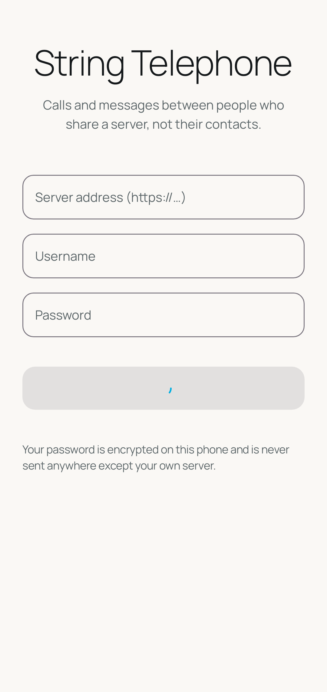
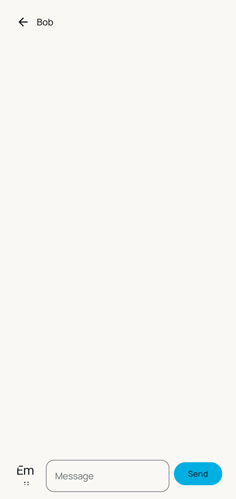
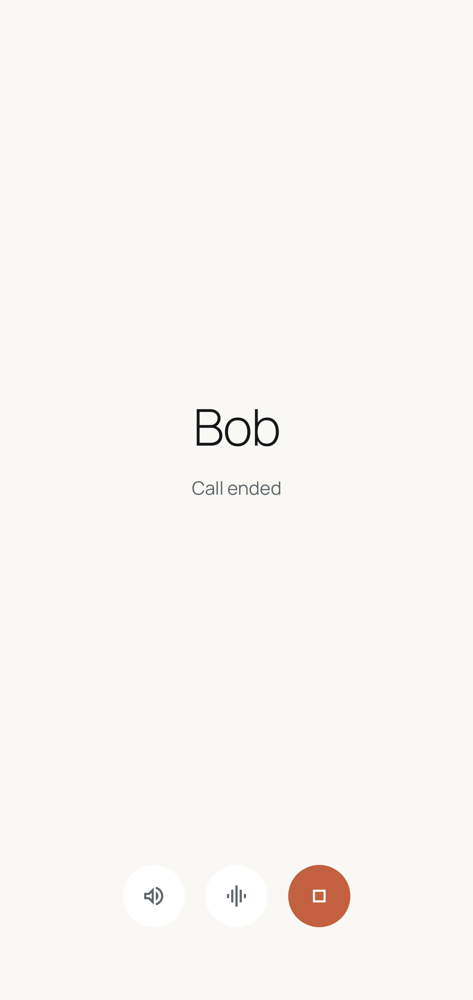
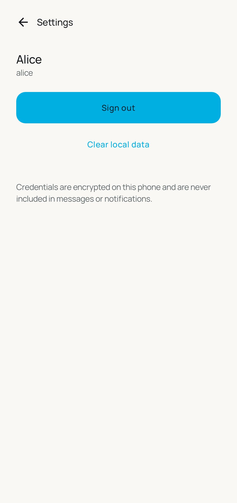

# String Telephone


Self-hosted one-to-one phone calls and messages for people who share a server,
not their contacts. An Android app plus a small companion API and an Asterisk
PBX you run yourself. No cloud, no vendor, no analytics.

**Status: prototype.** The build, unit tests, and the Asterisk SIP prototype
are green; the Android app is a functional prototype, not a release.

## Screens

| Onboarding | Contacts | Chat |
| --- | --- | --- |
|  |  |  |

| In-call | Settings |
| --- | --- |
|  |  |

These renders are generated by Robolectric screenshot tests
(`app/src/test/.../ui/ScreenshotTest.kt`) and land in `app/build/screenshots/`
on every test run — no device or emulator needed. The committed copies under
[docs/screenshots/](docs/screenshots/) are refreshed with the UI.

## What it does

- One-to-one calls between explicitly provisioned accounts (SIP/UDP, Opus).
- One-to-one text messages through a companion API with server persistence,
  idempotent sends, and cursor catch-up sync
  ([API reference](docs/protocol.md)).
- Contacts show full display names everywhere in the UI; usernames are used
  only for sign-in and addressing.
- Contacts with derived presence from PBX registration state.
- Calls ring while the app is alive (foreground or background); after
  force-stop the app must be reopened (ADR-0006 — no cold-start ringing).

## Repository layout

- `app/` — the Android application (GPL-3.0-or-later).
- `core/` — pure-Kotlin protocol and domain models shared by app and tests.
- `server/api/` — Kotlin/Ktor companion API with SQLite (AGPL-3.0-or-later).
- `server/asterisk/` — Asterisk 22 PJSIP configuration and container image.
- `server/compose.yaml` — prototype stack (Asterisk + API).
- `integration-tests/sip/` — dependency-free Node SIP scripts used as oracles.
- `docs/adr/` — architecture decision records.
- `docs/screenshots/` — committed app screenshots, regenerated with the UI.
- `scripts/` — development and verification scripts.

## Documentation

- [CONTRIBUTING.md](CONTRIBUTING.md) — development setup, change workflow,
  validation gates, pull-request expectations.
- [CODE_OF_CONDUCT.md](CODE_OF_CONDUCT.md) — community expectations and reporting.
- [docs/architecture.md](docs/architecture.md) — modules, runtime components,
  dependency boundaries, and call/message flows.
- [docs/protocol.md](docs/protocol.md) — companion API protocol: endpoints,
  authentication, idempotent sends, and cursor sync (promised by ADR-0003).
- [docs/operations.md](docs/operations.md) — running the prototype stack,
  provisioning users, environment variables, and the SIP prototype test.
- [docs/adr/](docs/adr/) — architecture decision records (PBX choice, SIP
  engine, messaging, licensing, SDK levels, background call policy).
- [SECURITY.md](SECURITY.md) — how to report vulnerabilities privately.
- [THIRD_PARTY_NOTICES.md](THIRD_PARTY_NOTICES.md) — third-party components
  and licences.
- [CHANGELOG.md](CHANGELOG.md) — notable changes per release.

## Design

The UI uses the Manrope typeface (SIL Open Font License, bundled in
`app/src/main/res/font/` with its licence in `app/src/main/res/raw/`) and a
Material 3 theme built from a small semantic palette: cyan brand
(`0xFF00AFE1`), porcelain/ink neutrals, and coral/amber accents reserved for
destructive and warning states. Light and dark variants are defined for every
colour; the accent set is exposed to screens through a `CompositionLocal`.
`scripts/check-design.mjs` pins the font files and the adaptive launcher icon
against the design reference.

Screenshots are generated without a device: `ScreenshotTest` renders each
screen through Robolectric native graphics at 1080×2280 and writes PNGs to
`app/build/screenshots/`. Run `./gradlew --no-daemon :app:testDebugUnitTest`
after a UI change and copy updated images into `docs/screenshots/`.

## Build

Install JDK 17 and an Android SDK (API 37), then:

```bash
export ANDROID_HOME="$HOME/Android/Sdk"
./gradlew --no-daemon :core:test :app:testDebugUnitTest :app:lintDebug \
  :app:assembleDebug :app:assembleRelease :server:api:test :server:api:installDist
```

Neither the app nor the server needs real credentials to build or unit-test.
See [CONTRIBUTING.md](CONTRIBUTING.md) for the full workflow.

### Install on a device or emulator

Connect a physical device with USB debugging enabled, or start an AVD in Android
Studio and wait for its home screen, then run:

```bash
scripts/deploy-device.sh
# Or, for an already running emulator:
scripts/deploy-emulator.sh
```

Both helpers build the debug APK, install it on one selected target, and launch
String Telephone. If multiple targets of the same type are ready, set
`DEVICE_SERIAL` or `EMULATOR_SERIAL` (from `adb devices`); `ANDROID_SERIAL` is
also supported. They respect `ANDROID_HOME`, `ANDROID_SDK_ROOT`, `JAVA_HOME`,
and tools on `PATH`, and never start or stop emulators automatically.
Debug APKs can contain development credentials from the ignored
`local.properties`; do not share them. Provisioned accounts and reachable API/PBX
services are still needed to exercise calls and messages.

## Prototype stack

The SIP path is verified against a live Asterisk with throwaway containers:

```bash
scripts/test-prototype.sh
```

This registers a provisioned user with digest authentication, completes a
two-party REGISTER-INVITE-200-ACK-BYE call, and asserts that a wrong-password
registration fails without creating a contact. It tears the stack down when
done (`--keep` leaves it running). See [docs/operations.md](docs/operations.md)
for the stack layout and provisioning commands.

## Security

Report vulnerabilities privately as described in [SECURITY.md](SECURITY.md).
Operator guidance lives in [docs/operations.md](docs/operations.md);
provisioning is via `stringtelephone-provision`.

## Licence

The Android app: GPL-3.0-or-later ([LICENSE](LICENSE)). The companion API:
AGPL-3.0-or-later ([server/api/LICENSE-AGPL](server/api/LICENSE-AGPL)).
Third-party components: [THIRD_PARTY_NOTICES.md](THIRD_PARTY_NOTICES.md).
